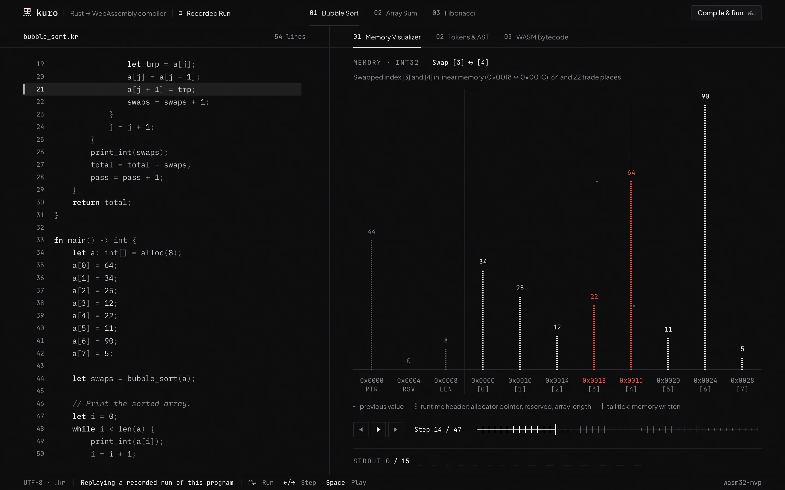
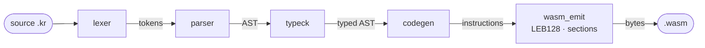
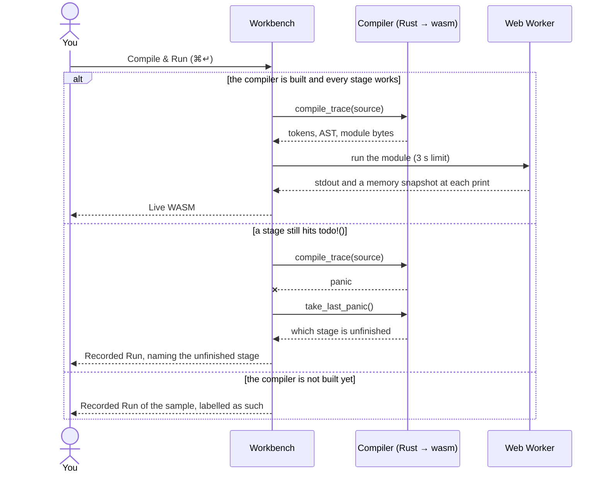

<div align="center">

# kuro

**A small statically typed language that compiles straight to WebAssembly bytecode.**<br>
No LLVM, no `wasm-encoder`: every byte of the module is written by hand in Rust.<br>
A browser workbench lets you watch the program run, one memory write at a time.

</div>



```rust
fn main() -> int {
    let a: int[] = alloc(3);
    a[2] = 9;
    return a[2] + len(a);      // 12
}
```

## Contents

- [Status](#status)
- [Getting started](#getting-started)
- [The language](#the-language)
- [How it works](#how-it-works)
- [The workbench](#the-workbench)
- [Compiler ↔ workbench contract](#compiler--workbench-contract)
- [Project layout](#project-layout)

## Status

kuro is being built stage by stage. Everything around the compiler stages is finished; the stages themselves are typed stubs that end in `todo!()` until they are implemented, and the test suite describes exactly what each one must do.

| Part | State |
|---|---|
| Shared types: tokens, AST, errors, execution trace | ✅ complete |
| Pipeline glue and the `wasm-bindgen` API | ✅ complete |
| Test suite: 139 tests, end-to-end ones executed under `wasmtime` | ✅ complete |
| Browser workbench | ✅ complete |
| Lexer · parser · type checker · code generator · wasm emitter | 🚧 in progress |

Until the stages work, the workbench replays recorded runs of the three sample programs, and says so on screen.

## Getting started

**Requirements:** a Rust toolchain and Node.js. Running the compiler in the browser also needs the `wasm32-unknown-unknown` target and [`wasm-pack`](https://rustwasm.github.io/wasm-pack/).

```sh
# Compiler
cargo test  --manifest-path compiler/Cargo.toml --no-fail-fast
cargo check --manifest-path compiler/Cargo.toml

# Workbench
cd web
npm install
npm run dev      # http://localhost:5173
npm run build    # type-check, then a production build into web/dist
npm run wasm     # compile the Rust compiler to wasm, into web/public/pkg
```

## The language

Three sample programs live in [`examples/`](examples): `bubble_sort.kr`, `array_sum.kr` and `fibonacci.kr`.

```rust
fn sum(a: int[]) -> int {
    let total = 0;
    let i = 0;
    while i < len(a) {
        total = total + a[i];
        i = i + 1;
    }
    return total;
}
```

### Types

| Type | Values | In WebAssembly |
|---|---|---|
| `int` | 32-bit signed integers | `i32` |
| `float` | 64-bit IEEE-754 | `f64` |
| `bool` | `true`, `false` | `i32` holding `1` or `0` |
| `int[]` | a reference to a fixed-length array of `int` | `i32` address into linear memory |

There are **no implicit conversions**: `1 + 2.0`, `let x: float = 1;` and `if 1 { }` are all type errors.

### Operators

From loosest to tightest binding; every binary operator is left-associative.

| Level | Operators |
|:---:|---|
| 1 | `\|\|` |
| 2 | `&&` |
| 3 | `==` `!=` |
| 4 | `<` `<=` `>` `>=` |
| 5 | `+` `-` |
| 6 | `*` `/` `%` |
| 7 | unary `-` `!` |
| 8 | indexing `a[i]` |

### Builtins

| Signature | Behaviour |
|---|---|
| `print_int(value: int)` | Hands `value` to the host for display. |
| `print_float(value: float)` | Hands `value` to the host for display. |
| `alloc(n: int) -> int[]` | Allocates a new array of `n` zeros and returns it. |
| `len(a: int[]) -> int` | The number of elements `a` was allocated with. |

### Semantics worth knowing

- Integer arithmetic wraps (two's complement); division truncates toward zero, and dividing by zero traps.
- `&&` and `||` short-circuit. Evaluation is left to right.
- Arrays are references: passing one to a function shares it, so the callee can write to the caller's array.
- Indexing is not bounds-checked; only an address past the end of the 64 KiB memory traps.
- Functions may be called before they are defined, and may recurse. Every program defines a parameterless `main`.

## How it works

### The pipeline



Each stage is one file in [`compiler/src`](compiler/src). Errors carry the stage that raised them and a source span, so the workbench can underline the exact token.

### What a module contains

Every program compiles to a module with the same six sections, in this order:

| Id | Section | Contains |
|:---:|---|---|
| 1 | Type | function signatures |
| 2 | Import | `env.print_int` and `env.print_float`, provided by the host |
| 3 | Function | the signature of each function defined in the module |
| 5 | Memory | one 64 KiB page of linear memory |
| 7 | Export | `memory`, `alloc` and every user function, so the host can call `main` |
| 10 | Code | the body of each function |

Function indices are fixed: `0` is `print_int`, `1` is `print_float`, `2` is the runtime's `alloc`, and user functions follow from `3` in source order.

### Linear memory

Memory starts zeroed. The first two words belong to the runtime; arrays are bump-allocated after them and never freed.

```
address   contents
0x0000    heap pointer: address of the next free byte (0 until the first alloc)
0x0004    reserved, always 0
0x0008    heap: arrays, one after another, growing upwards
   ...
0xFFFF    last byte of the single 64 KiB page
```

An `int[]` is the address of a length header followed by its elements, all little-endian `i32`:

```
 ptr           ptr+4         ptr+8         ptr+12
  ┌─────────────┬─────────────┬─────────────┬────
  │ length      │ element 0   │ element 1   │ ...
  └─────────────┴─────────────┴─────────────┴────
```

After `let a: int[] = alloc(3); a[0] = 7; a[1] = 8; a[2] = 9;` memory reads:

```
address  bytes          value  meaning
0x00     18 00 00 00    24     heap pointer (8 + 4 + 3×4)
0x04     00 00 00 00    0      reserved
0x08     03 00 00 00    3      a: length
0x0C     07 00 00 00    7      a[0]
0x10     08 00 00 00    8      a[1]
0x14     09 00 00 00    9      a[2]
```

This is exactly what the workbench's Memory view draws: `PTR`, `RSV` and `LEN` are the first three cells, and the array follows.

### Compile & Run



## The workbench

Open a sample and press **Compile & Run**. Three views share one step cursor:

| View | What it shows |
|---|---|
| **Memory Visualizer** | Linear memory as labelled Int32 cells, one snapshot per print. Cells written by the current step turn vermilion; a tick marks each cell's previous value; the step is narrated in plain English. |
| **Tokens & AST** | The token stream and the syntax tree, with a filter. Click a token or a node to jump to it in the source. |
| **WASM Bytecode** | The module's sections, a hex dump and the disassembled instructions, linked byte for byte. |

| Key | Action |
|---|---|
| `⌘↵` / `Ctrl↵` | compile and run |
| `←` `→` (`Shift` for ×5) · `Home` `End` | step through the run |
| `Space` | play / pause |
| `1` `2` `3` | switch view |
| `⌘F` / `Ctrl F` | filter tokens and the tree |
| `Esc` | leave the editor (Tab moves on) or clear the filter |

The sample, the view and the filter live in the URL, so any state can be shared or reloaded. The header always says which mode produced what you see:

- **Recorded Run:** a replay of the sample's recorded trace (`web/src/trace/fixtures`). Edits are not compiled in this mode, and the workbench says so instead of pretending.
- **Live WASM:** after `npm run wasm`, your code is compiled by the Rust compiler and the module it emits is executed in a Web Worker.

The workbench works offline (fonts are bundled), respects reduced motion, is fully keyboard-operable and adapts from phones to wide desktops.

## Compiler ↔ workbench contract

| Piece | Where | Contract |
|---|---|---|
| `compile_trace(source) → string` | `compiler/src/lib.rs` (`wasm_api`) | JSON `ExecutionTrace` with the compile-time half filled: `tokens`, `ast_json`, `wasm_bytes`, `diagnostics` (at most one error). `steps` and `stdout` are empty. |
| `compile_json(source, up_to) → string` | same | The pipeline output up to `"lex"`, `"parse"`, `"typecheck"` or `"codegen"`, with every artifact produced before a failure still present. |
| `take_last_panic() → string \| undefined` | same | The message of the last Rust panic. A `todo!()` reaches JavaScript as a thrown `WebAssembly.RuntimeError`; the workbench reads this message, names the unfinished stage and falls back to the recorded trace. |
| Spans | `compiler/src/token.rs` → `web/src/lib/ast.ts` | `start`/`end` are UTF-8 byte offsets, `line`/`col` are 1-based. Byte offsets are converted to string offsets once, when the tree is built. |
| Host imports | `web/src/trace/worker.ts` | `env.print_int(i32)` and `env.print_float(f64)`. |
| Memory snapshots | the same worker | One before `main`, one at each print, one after `main` returns or traps. Cell *i* is the little-endian `i32` at byte `4i`, up to the heap pointer. A run stops after 3 seconds. |
| TypeScript mirror | `web/src/trace/types.ts` | Field for field the same as `compiler/src/trace.rs`; changing one means changing the other. |

## Project layout

```
kuro/
├── compiler/                Rust crate (cdylib + rlib)
│   ├── src/
│   │   ├── lexer.rs         source → tokens
│   │   ├── parser.rs        tokens → AST
│   │   ├── typeck.rs        static semantics, type annotations
│   │   ├── codegen.rs       AST → module bytes
│   │   ├── wasm_emit.rs     LEB128, names, sections, opcode constants
│   │   ├── token.rs · ast.rs · error.rs · trace.rs
│   │   └── lib.rs           pipeline glue and the wasm-bindgen API
│   └── tests/               lexer, parser, type checker, codegen, end-to-end
├── examples/                bubble_sort.kr · array_sum.kr · fibonacci.kr
├── web/                     the workbench (Vite + React + TypeScript)
│   ├── src/components/      editor, memory view, inspector, scrubber, ...
│   ├── src/trace/           compile, run, worker, recorded fixtures
│   └── src/styles/          one stylesheet per area; tokens in src/index.css
└── docs/                    README assets
```
