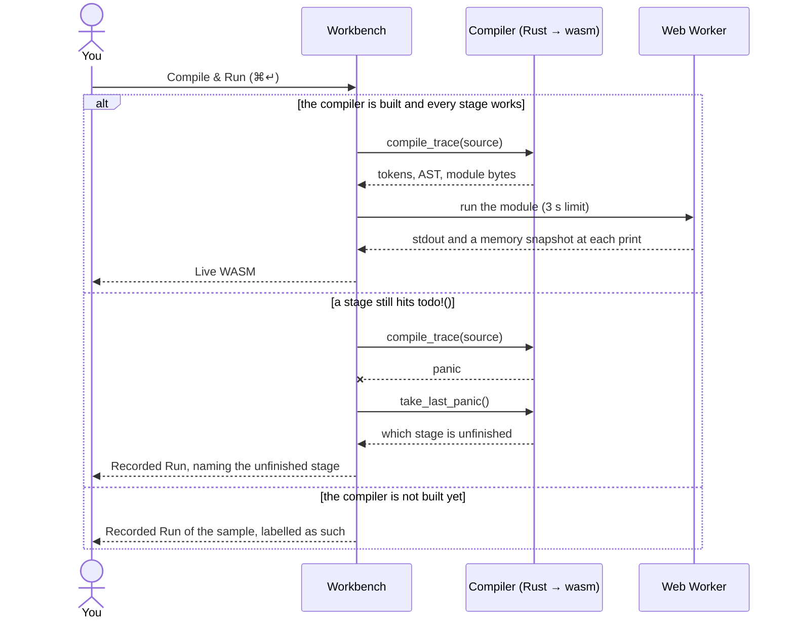

# kuro

kuro is a small statically typed language whose Rust compiler emits WebAssembly MVP bytecode by hand: no LLVM, no `wasm-encoder`, every byte written by the crate itself. A browser workbench compiles and runs a program, then lets you step through its linear memory, tokens, syntax tree and module bytes.


```
source (.kr) ─▶ lexer ─▶ parser ─▶ type checker ─▶ codegen ─▶ wasm_emit ─▶ .wasm ─▶ workbench
                tokens   recursive   two passes:     stack      LEB128,               run in a
                + spans  descent,    signatures,     machine,   sections              Web Worker,
                         precedence  then bodies     linear                           memory snapshot
                         climbing                    memory                           at every print
```

**Status.** The shared types, pipeline glue, 139 tests and the workbench are complete. The five compiler stages are typed `todo!()` stubs while they are implemented; until then the workbench replays recorded runs of the sample programs and says so.

## Commands

```sh
cargo test  --manifest-path compiler/Cargo.toml --no-fail-fast
cargo check --manifest-path compiler/Cargo.toml

cd web
npm install
npm run dev      # http://localhost:5173
npm run build    # type-check, then build into web/dist
npm run wasm     # compile the Rust compiler for the browser (wasm32-unknown-unknown + wasm-pack)
```

## Repository

```
compiler/src/   lexer.rs · parser.rs · typeck.rs · codegen.rs · wasm_emit.rs    the five stages
                token.rs · ast.rs · error.rs · trace.rs · lib.rs              types, glue, wasm-bindgen API
compiler/tests/ lexer · parser · type checker · codegen · end to end (under wasmtime)
examples/       bubble_sort.kr · array_sum.kr · fibonacci.kr
web/src/        components/ · trace/ (compile, run, worker, recorded runs) · styles/ · index.css (tokens)
docs/           README assets
```

## Language

```rust
fn sum(a: int[]) -> int {
    let total = 0;
    let i = 0;
    while i < len(a) {
        total = total + a[i];
        i = i + 1;
    }
    return total;
}
```

| | |
|---|---|
| Types | `int` (i32) · `float` (f64) · `bool` · `int[]` (an address into linear memory). No implicit conversions. |
| Operators, loosest first | `\|\|` · `&&` · `==` `!=` · `<` `<=` `>` `>=` · `+` `-` · `*` `/` `%` · unary `-` `!` · `a[i]`. All binary operators are left-associative. |
| Builtins | `print_int(int)` · `print_float(float)` · `alloc(n) -> int[]` · `len(int[]) -> int` |
| Statements | `let` (always initialised) · assignment · `if` / `else if` / `else` · `while` · `return`. Braces are mandatory. |
| Semantics | Integer arithmetic wraps; division truncates toward zero and traps on zero. `&&` and `\|\|` short-circuit, left to right. Arrays are references. Indexing is unchecked. |

## Linear memory

One zeroed 64 KiB page. Arrays are bump-allocated and never freed; each is a length header followed by its elements, all little-endian `i32`.

| Address | Cell | Meaning |
|---|---|---|
| `0x0000` | `PTR` | heap pointer: the next free byte (0 until the first `alloc`) |
| `0x0004` | `RSV` | reserved, always 0 |
| `0x0008` | `LEN` | the first array's length |
| `0x000C` | `[0]` | its first element; `[i]` is at `ptr + 4 + 4i` |

The module always has six sections (Type, Import, Function, Memory, Export, Code) and fixed function indices: `0` `print_int`, `1` `print_float`, `2` `alloc`, then user functions in source order.

## Compile & Run



## Workbench

| View | Shows |
|---|---|
| Memory Visualizer | Linear memory as labelled Int32 cells, one snapshot per print. The cells a step writes turn vermilion; each step is narrated. |
| Tokens & AST | The token stream and syntax tree, filterable; click any row to jump to its source. |
| WASM Bytecode | Sections, a hex dump and the disassembly, linked byte for byte. |

`⌘↵` run · `←` `→` step (`Shift` ×5) · `Space` play · `1` `2` `3` views · `⌘F` filter · `Esc` leave the editor. State lives in the URL. It works offline, honours reduced motion, is keyboard-operable throughout and adapts from phones to wide screens.

## Compiler ↔ workbench contract

| Piece | Where | Contract |
|---|---|---|
| `compile_trace(source)` | `compiler/src/lib.rs` | JSON `ExecutionTrace`: `tokens`, `ast_json`, `wasm_bytes`, at most one diagnostic. `steps` and `stdout` stay empty. |
| `compile_json(source, up_to)` | same | Output up to `lex`, `parse`, `typecheck` or `codegen`, keeping every artifact made before a failure. |
| `take_last_panic()` | same | The last Rust panic's message; a `todo!()` names the unfinished stage. |
| Spans | `token.rs` → `web/src/lib/ast.ts` | UTF-8 byte offsets; `line`/`col` 1-based. |
| Host imports | `web/src/trace/worker.ts` | `env.print_int(i32)`, `env.print_float(f64)`. |
| Snapshots | same | Before `main`, at each print, after return or trap; cell *i* is the `i32` at byte `4i`. |
| Types | `web/src/trace/types.ts` | Mirrors `compiler/src/trace.rs` field for field. |
